# F1 Race Strategy Lab

I'm a McLaren fan, and every time the pit wall makes a call (stop now, stay out, go long on the hards) I end up arguing with myself about whether it was right. This project is my attempt to put numbers on that argument.

Using lap-by-lap data from 2022 to 2025, I built a model that predicts how a lap will differ from a driver's normal pace, checked how honest its uncertainty is, and then used it in a race simulator that compares pit strategies. It's a personal project, so it also has the parts that didn't work, and there's a McLaren section near the end.

**The short version**

| | On 2025, a season the models never saw |
|---|---|
| Lap-time model | 0.62 s average error. The best simple baseline is 0.87 s. |
| Prediction intervals | The ones I call "80%" contained 81.4% of laps. |
| Safety car rate | About right on average (1.15 expected per race, 1.05 happened). |
| Race simulator | Median error of 30 s on a ~5,500 s race, but its intervals were too narrow (80% claimed, 65.6% held). |

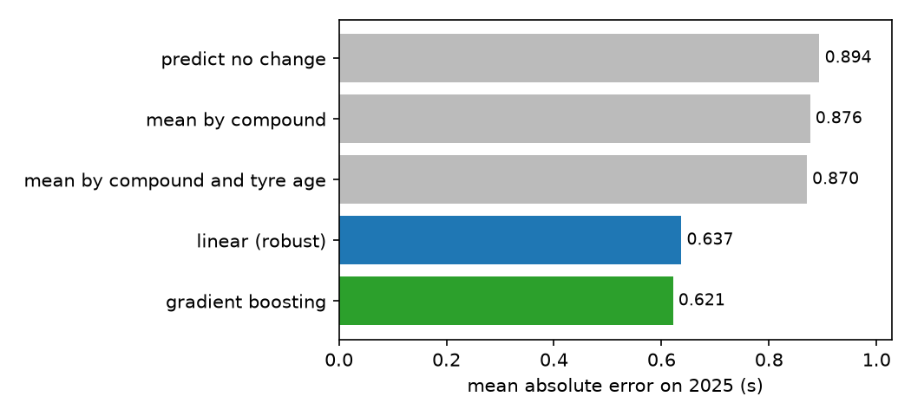

## Contents

1. [The question](#the-question)
2. [Pipeline at a glance](#pipeline-at-a-glance)
3. [How it works](#how-it-works)
4. [Decisions and the evidence behind them](#decisions-and-the-evidence-behind-them)
5. [Things that went wrong](#things-that-went-wrong)
6. [Results on 2025](#results-on-2025)
7. [The McLaren corner](#the-mclaren-corner)
8. [What the results mean](#what-the-results-mean)
9. [What I'd do next](#what-id-do-next)
10. [Limits and how the data was used](#limits-and-how-the-data-was-used)
11. [Related work](#related-work)
12. [Using it](#using-it)

## The question

Can you predict an F1 lap time from tyre age, fuel and conditions? How sure can the model honestly be? And is that good enough to say anything useful about a pit strategy?

The middle question is the one I cared about most. Plenty of models give you a number. I wanted one that also says how sure it is, and then I wanted to test that claim against races it hadn't seen.

## Pipeline at a glance

| Notebook | What it does | The one thing to know |
|---|---|---|
| 01 | Looks at the raw lap table | 75% of the unusually slow laps are safety car, VSC or red flag laps |
| 02 | Tyre wear and fuel burn | Fuel burn hides tyre wear, so raw data says tyres get faster |
| 03 | Baselines | Models that don't know the lap number are barely better than guessing |
| 04 | Linear model | A fuel term cuts error from 0.85 s to 0.63 s |
| 05 | Gradient boosting | Small beats big; fuel and tyre age are the only inputs that clearly matter |
| 06 | Prediction intervals | Conformal intervals hit their claimed level on a new season |
| 07 | Safety cars | Lap 1 is about 17% likely to bring one; after lap 2 the risk is flat |
| 08 | Race simulator | Replaying real 2024 races: right to ~18 s, honest intervals |
| 09 | Final test on 2025 | Run once, everything frozen. Simulator did worse here |
| 10 | Figures for this README | Includes the McLaren charts |

## How it works

### The data

Every race from 2022 to 2025: lap time, compound, tyre age, pit stops, weather, and safety car status. That's 100,701 laps from 92 races.

I use two sources. **FastF1** covers 2022. Its docs say timing data goes back to 2018, but from my machine F1's timing server returned an authorisation error for 2023 onwards, so I added **[OpenF1](https://openf1.org)** for 2023 to 2025. Both are normalised into one lap table. The raw data isn't in the repo, and `python -m f1lab.ingest` rebuilds it. Check each source's terms before reusing it.

### The target

Raw lap times depend mostly on the car, the driver and the track. I'm interested in tyres and fuel, so the target is

```
delta = lap_time - median clean lap time of that driver in that race
```

That removes car, driver and track pace and leaves what changes during a race. The price is that you need a base pace as an input. In my replay test it's the race's own median, which is only known in hindsight, so keep that in mind when reading the simulator results.

### Fuel and tyres

Tyre age and lap number rise together, so they're collinear, and that's why the raw data lies. Cars get lighter every lap and the gain beats the wear, so the median lap gets *faster* with tyre age on every compound (left chart). A regression with race and driver fixed effects plus a fuel term pulls them apart. Without it wear comes out negative. With it, wear is positive and ordered soft > medium > hard (right chart).

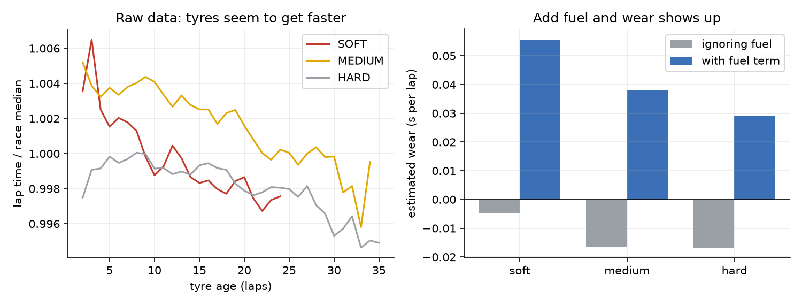

The models then use two fuel inputs: laps remaining, and the fraction of the race remaining. Fuel burned per lap is roughly total fuel divided by race length, so the net effect per lap is `beta_frac / N + beta_laps`. With the fitted values that's about 0.053 s per lap in a 57-lap race and 0.032 s in the 78-lap Monaco race. A model using the fraction beat one using raw laps remaining (0.643 against 0.686 s).

### The models

- **Linear (Huber loss).** About 0.3% of laps are real incidents (spins, off-track moments) that can be 30 s slow. They dominate squared error, so I use Huber loss for fitting and mean absolute error for scoring.
- **Gradient boosting (LightGBM, L1 loss).** 8 leaves, 150 trees. The size came from 5-fold cross-validation grouped by race, using only the training seasons. Grouping matters because laps from one race share conditions. After that, bigger models only fit race-specific noise.

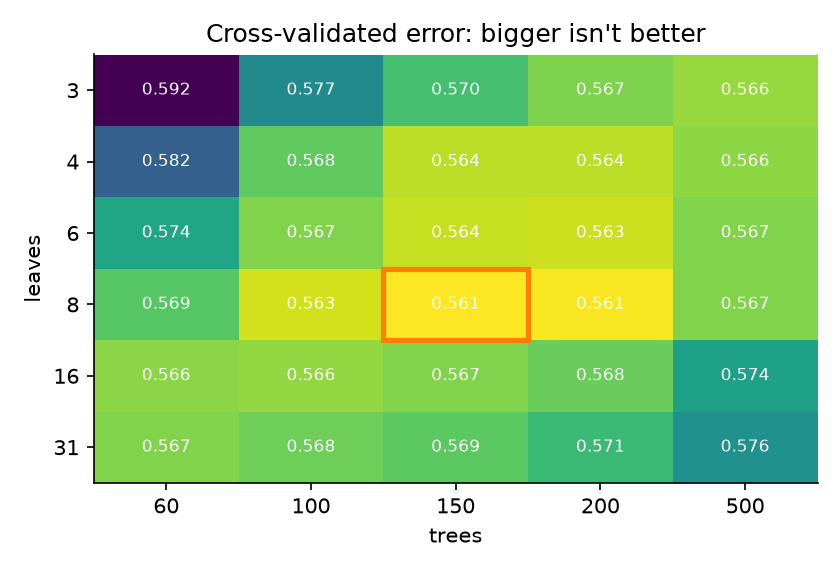

### Prediction intervals

I use conformalized quantile regression (CQR). Fit the 10th and 90th percentile models, score each calibration lap by how far it fell outside that band,

```
score = max(q_lo(x) - y,  y - q_hi(x))
```

then widen the band by the `ceil((n+1)(1-alpha))`-th smallest score. That gives coverage without assuming the model is right, but only if laps are exchangeable, which they aren't (laps in a race are correlated, and seasons drift). So I don't take the guarantee on trust. I compute the scores out of fold, grouped by race, and then measure coverage on seasons the model never saw.

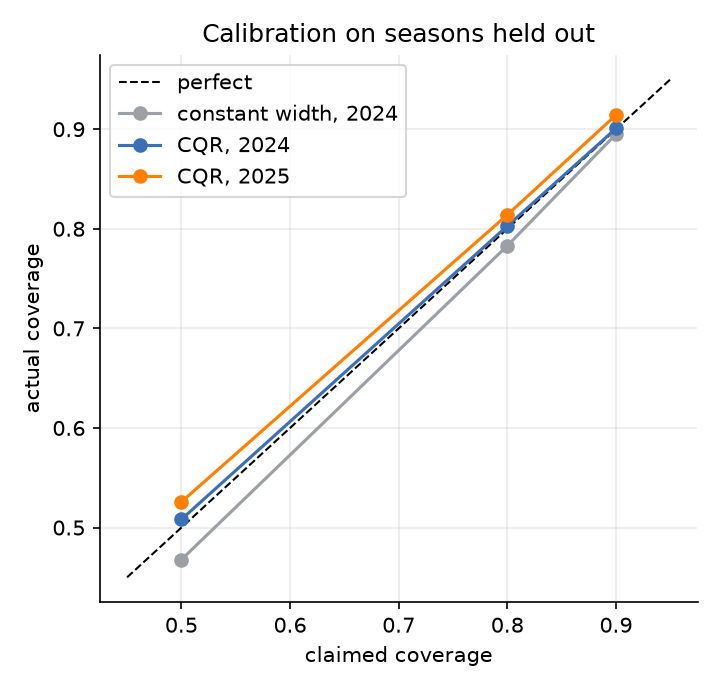

I also tried a plain constant-width interval around the point forecast. It under-covers at lower levels (0.468 for a claimed 50%), and CQR costs about 11% more width to fix it.

### Safety cars

A safety car or VSC lets you pit cheaply, so a strategy model needs to know how likely one is. I model the chance that one *starts* on a lap, given the race was under green the lap before. The first lap is about 17% likely to bring one and lap 2 about 6.5%. After that it's roughly 1–2% per lap, flat through the race.

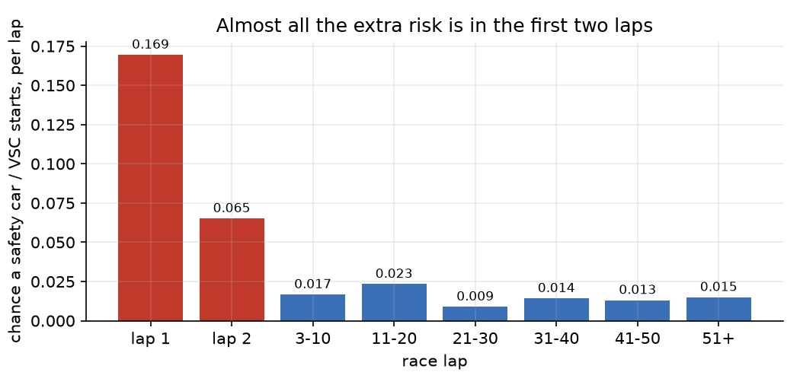

I use two rates: one for laps 1–2 and one for the rest, fitted by counting events over laps at risk. I tried a rate by race stage (worse) and a per-track multiplier shrunk toward the average (a ~1% log-loss gain). Neither predicted which held-out races got a safety car, so I kept the simple one. There are only about 60 events in the training seasons, so a richer model would be fitting noise.

### The simulator

For one driver, one race, many runs. Each run draws a safety car timeline from the hazard model, then builds the race lap by lap:

```
green lap:    base_pace + f(compound, tyre_age, lap, ...) + u_stint + e_lap
safety car:   base_pace * (m_period + e_lap)
lap 1:        base_pace * m_1
pit stop:     + a loss sampled from history, tyre age resets
```

The noise comes from out-of-fold residuals, split into a shift shared by a whole stint (sd about 0.49 s) and lap-to-lap noise (sd about 0.97 s). That split matters because a driver is simply faster or slower on a given stint, and treating every lap as independent made the intervals too narrow. Safety car laps get one multiplier per *period* for the same reason.

Pit stop loss is the in-lap plus out-lap time minus what the rest of the field did on those laps. On green flags it's stable at about 22 to 23 s every season (roughly 20 to 27 s depending on the track). Under a safety car it's cheaper and has been falling:

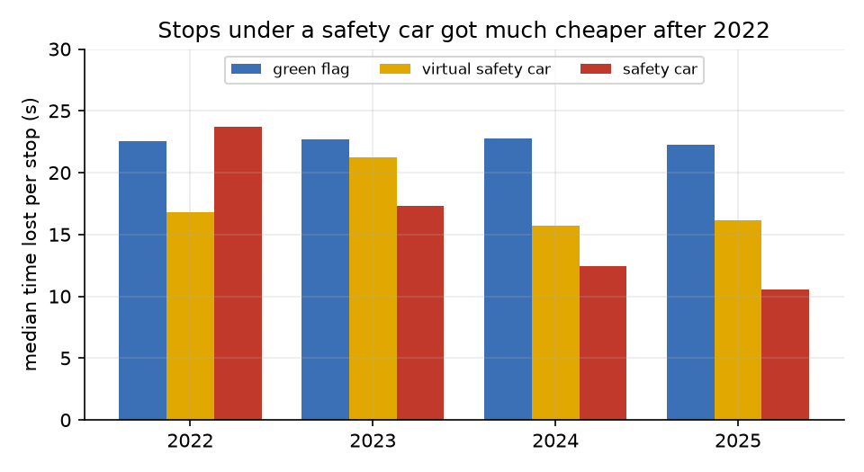

To compare strategies, every plan runs against the same random draws (common random numbers), so a safety car helps or hurts all of them together and the differences are far less noisy than the totals.

### How I test the simulator

I replay real races. For each driver who finished the full distance, I rebuild their actual strategy (pit laps, compounds, how old each set was) and the observed safety car laps, simulate the race, and compare total time with the real one. It's a check on the lap-time model, pit costs and safety car costs. It is not a test of forecasting pace or of predicting safety cars.

## Decisions and the evidence behind them

| Decision | What I compared | What decided it |
|---|---|---|
| Predict delta from the driver's own pace | Absolute lap time | Removes car and track speed so the model can focus on tyre and fuel |
| Split by season, never by lap | Random split | Laps in a race are correlated, so a random split leaks |
| MAE and Huber loss | Squared error | 0.3% of laps are 30 s incidents that dominate RMSE |
| Fuel as a fraction of the race left | Laps remaining only | MAE 0.643 vs 0.686 |
| 8 leaves, 150 trees | Up to 31 leaves, 500 trees | Grouped CV: larger got worse (0.576 at 31/500 vs 0.561) |
| Keep all inputs | Dropping track, temperature, compound | CV showed no input beyond fuel and tyre age mattered much, and I didn't want to tune on the validation season |
| CQR intervals | Constant width | Constant width under-covered (0.468 for a claimed 50%) |
| Two-rate safety car model | Constant rate; race stage; per-track shrinkage | Laps 1–2 split cut log loss 0.0974 to 0.0932. The rest didn't predict held-out races |
| Safety car costs from OpenF1 seasons only | All seasons | 2022 (FastF1) averages 1.33× a normal lap vs 1.44–1.49× later, an artefact of labelling |
| One multiplier per safety car period | One per lap | Per-lap draws gave 67% coverage in safety car races; per-period gave 85% |
| Exclude 12 wet or drying races | Keep them | They contaminated every model; fixing it improved all of them |

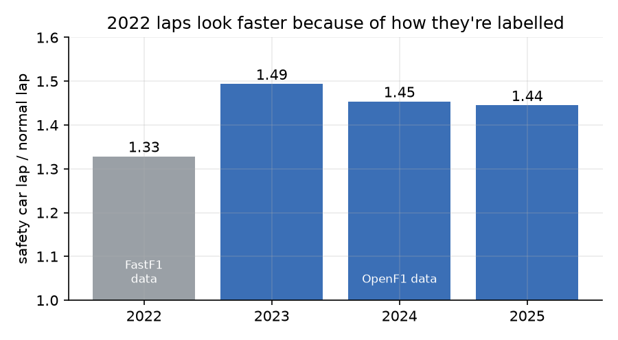

## Things that went wrong

- **LightGBM wouldn't import on macOS.** It needed OpenMP (`brew install libomp`).
- **FastF1 couldn't load 2023 onwards**, even though the docs say it should. I added OpenF1 as a second source.
- **The two sources name tracks differently.** "Monaco" and "Monte Carlo" showed up as two circuits. Seven needed mapping, or every per-track result would have been split in half.
- **Wet races leaked into everything.** My first rule for spotting them compared early and late laps, but a wet start leaves no clean early laps, so the check returned a missing value and the race was quietly treated as dry. I only found it because one race had very poor interval coverage and I looked at why. The fix was also to flag races where a lot of laps were on intermediate or wet tyres. It improved every model, and I had to re-run and rewrite four notebooks.
- **The rain flag can't be trusted.** At Spa 2025 the track dried out after a wet start while the flag said dry all race.
- **I mis-measured a calibration check.** My first safety car check used only the laps at risk. A race with a long safety car loses at-risk laps, which built in a fake negative correlation, and I nearly picked a model because of it.
- **Safety car laps changed between seasons**, and it was the data source, not the sport.
- **Plain bugs:** a strategy search about 100× too slow because the lap table was recomputed for every plan, and a notebook cell that recomputed the same set 100,000 times and hung for minutes.

## Results on 2025

All numbers are on 2025, with models trained on 2022 to 2024.

### Lap-time model

20,807 laps from 21 races. Error is in seconds, against the driver's own median pace.

| Model | Mean abs error | RMSE |
|---|---|---|
| Predict no change | 0.894 | 1.550 |
| Mean by compound | 0.876 | 1.537 |
| Mean by compound and tyre age | 0.870 | 1.532 |
| Linear (robust) | 0.637 | 1.379 |
| Gradient boosting | **0.621** | 1.370 |

Gradient boosting is about 29% better than the best simple baseline. Its edge over the linear model is small (0.016 s here, 0.030 s on 2024).

### Prediction intervals

| Claimed | Actual | Average width |
|---|---|---|
| 50% | 52.6% | 0.89 s |
| 80% | 81.4% | 1.80 s |
| 90% | 91.4% | 2.55 s |

### Safety cars

Log loss 0.0845 against 0.0917 for a single rate. The model expects 1.15 starts per race and there were 1.05 (22 in 21 races). It can't say *which* races will have one. I tested that and nothing I tried could.

### Race simulator (replay of 2025)

276 driver-races from 20 races.

| | Median error | 80% interval holds |
|---|---|---|
| Just base pace × laps | 164 s | – |
| Simulator | 30.3 s | 65.6% |
| Same simulator with no tyre or fuel effect | 28.1 s | 72.1% |

Claimed 50%, 80% and 90% intervals held 41.7%, 65.6% and 77.5%. On 2024 the same design had a median error of 18.1 s and was well calibrated (52.9%, 80.2%, 89.4%).

The error is mostly a race-level offset. The average error differs between races by about 52 s (standard deviation), but drivers inside one race differ from each other by only about 22 s, and three races account for 60% of the squared error. How a particular race's safety cars play out shifts every driver together.

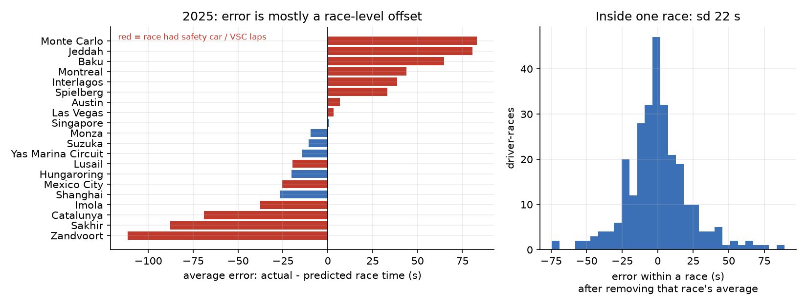

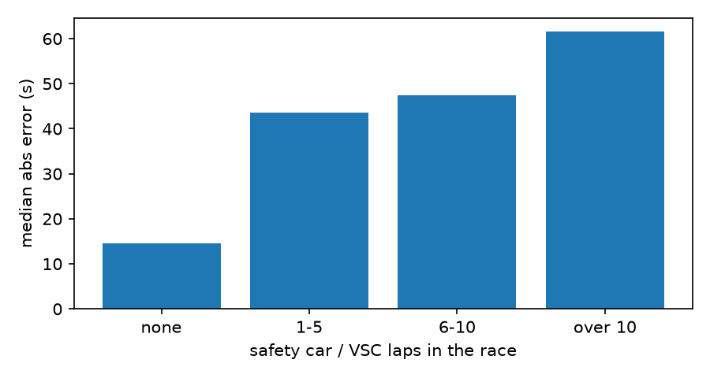

## The McLaren corner

I'm a McLaren fan, so I looked at Norris and Piastri in the data. This section is descriptive, uses 2025 after the final test was already done, and isn't part of any model. I report it whichever way it came out.

**Pit stops: a real improvement.** Using the same stop-loss measure as above (in-lap plus out-lap time against the field, green flag only), Norris and Piastri were 4th and 5th fastest of 20 drivers in 2025, at about 20.9 s against a 22.2 s field median. In 2023 Norris was 13th and Piastri 8th. That's consistent with McLaren's stops getting better, though the measure also includes pit-lane and in/out-lap driving, so it isn't purely the crew.

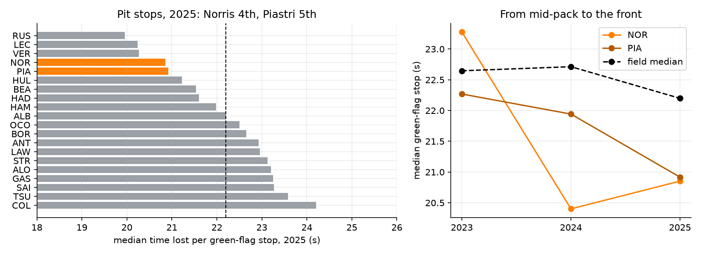

**Easy on tyres? Not visibly.** As a rough proxy I took the model's residual on laps with tyres 15 or more laps old. A driver who manages tyres well should come out faster than the model expects. Norris ranks 10th and Piastri 8th of 20, and their 90% ranges include zero, as do most drivers' (four sit clearly above it). This data doesn't show McLaren as unusually kind to its tyres. It's a crude proxy that mixes in fuel, compound and traffic, so I wouldn't read it as proof either way.

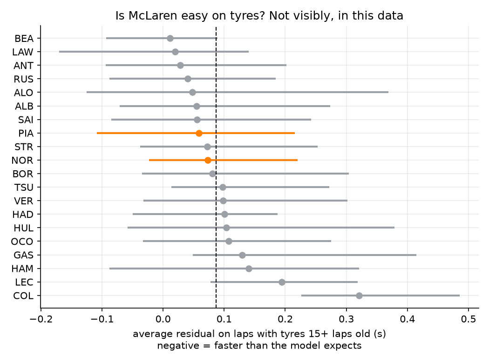

**An interval, up close.** This is the model's 80% interval for Norris at the first 2025 race in the test set (Shanghai; I took the first race in calendar order with enough laps, not the nicest-looking one). 75% of his laps fell inside it. The band follows the downward trend through the race. His last two laps sit well above it.

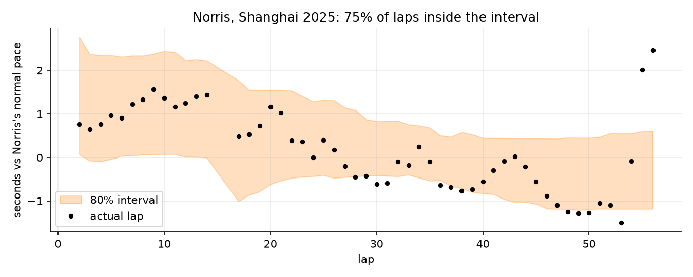

**The simulator replays McLaren's races well, with a small sample.** Median error for Norris and Piastri was 22 s against 33 s for everyone else, with 78% of results inside the 80% interval against 64%. That's only 37 driver-races, so I'd call it a hint at most.

## What the results mean

**What held up.** Fuel burn is the biggest factor in a lap time, and a model that knows about it is close to 30% better than one that doesn't. The intervals do what they claim on seasons the model never saw. The safety car rate is about right on average.

**What didn't.** The simulator's total-time intervals were too narrow on 2025, mostly because of race-level shifts an average can't capture. That should matter less when comparing strategies inside one race, but I haven't tested that directly.

**The tyre model doesn't help the race total.** A simulator with no tyre or fuel effect did slightly better. A driver's base pace is their own median lap from that race, so it already absorbs the average shape, and the total barely depends on how time is spread across stints. If the tyre model is useful, it's for comparing strategies, and that part isn't well tested here.

**A check after seeing the 2025 result.** Stops under a safety car or VSC got cheaper every year (23.7 s in 2022, then 17.3, 12.5 and 10.5 s). I wondered if that explained the miss, so I tried learning those costs from 2024 only. It barely moved anything (median error 30.3 s to 29.7 s), so the drift isn't the explanation. I did this after seeing the test result, so I haven't treated it as a tuned model.

**On strategy advice.** For the 2024 Sakhir winner the simulator preferred a one-stop over the two-stop he ran, by about 14 s on average. I wouldn't read that as advice. In quiet 2025 races it was too pessimistic about one-stops by about 16 s, so it leans toward recommending more stops than were needed, and a near-linear wear model can't see a tyre cliff.

## What I'd do next

- **Let safety car costs vary per race** with a shared random effect, so intervals widen where they should. That's the clearest next step given where the error sits.
- **Model tyre wear per track and allow a cliff**, not one nearly linear shape per compound.
- **Test strategy comparisons directly**, for example whether the simulator ranks one-stop against two-stop plans correctly within the same race across many races.
- **Forecast base pace** from practice data instead of using the race median in hindsight.
- **Add more seasons.** Three training seasons is thin. Older seasons would help, but the 2022 rules changed the cars.
- **Compare against published strategy models**, which I only read the abstracts of.

## Limits and how the data was used

- **Base pace and safety car laps are known in hindsight** in the replay test. It checks the lap-time model, pit costs and safety car costs, not pace forecasting or safety car prediction.
- **Cleaning rules were set looking at all four seasons.** The thresholds for wet races, extreme slow laps and drying starts were chosen while I could see 2025, and the Spa 2025 plot is where I first noticed the wet-race problem. Model fitting and tuning used 2022 to 2024 only, and the 2025 results were produced once. Three 2025 races (Melbourne, Silverstone, Spa) are excluded by the wet-race rules, so the test set has 21 races, not 24.
- **Dry races only.** Twelve wet or drying races across the four seasons are excluded.
- **One test season**, and 2024 and 2025 gave noticeably different simulator results.
- **Few safety car events** (about 60 in the training seasons).
- **The two sources label safety car laps slightly differently.** FastF1 (2022) is less precise than OpenF1 (2023 on).
- **The McLaren section** is descriptive and uses driver codes (NOR, PIA) as the team. Pit stop loss includes more than crew time, and the tyre residual is a crude proxy.
- **Used tyre sets** are handled from real data in the replay, but the strategy search assumes every later stint starts on a new set.

## Related work

I did a short search after the main build. I only read the abstracts, so I'm not claiming a detailed comparison.

- Thomas et al., [*Explainable Reinforcement Learning for Formula One Race Strategy*](https://arxiv.org/abs/2501.04068) (2025), trains a reinforcement learning agent to choose tyre compounds and stop timing and compares it with hard-coded baselines.
- Fieni et al., [*Towards Learning-Based Formula 1 Race Strategies*](https://arxiv.org/abs/2512.21570) (2025), optimises strategy including energy allocation, tyre wear and pit timing, and trains an agent to approximate the optimum.
- Romano, Patterson and Candès, [*Conformalized Quantile Regression*](https://arxiv.org/abs/1905.03222) (NeurIPS 2019), is the method behind the intervals.

Those two F1 papers are about finding good strategies. This project asks something smaller: how honest is the lap-time forecast, and does a simulator built on it match what really happened when replayed against past races? It doesn't try to beat them at choosing strategies.

## Using it

### Setup

```bash
python3 -m venv .venv && source .venv/bin/activate
pip install -r requirements.txt
pip install -e .
python -m ipykernel install --user --name f1lab
```

On macOS, LightGBM also needs `brew install libomp`.

### Build the data

```bash
python -m f1lab.ingest   # downloads and caches FastF1 (2022) and OpenF1 (2023-2025), takes several minutes
python -m f1lab.clean    # writes data/laps_clean.parquet
```

Then open the notebooks in `notebooks/` and run them in order.

### Rank strategies for a race

```bash
python -m f1lab.cli --track Sakhir --laps 57 --pace 95.5 --track-temp 30 --air-temp 25
```

`--pace` is the driver's typical clean lap in seconds. It prints the plans with the lowest average race time:

```
2112 plans, 200 simulated races each. Best first:

     plan  stops      mean behind   sd beats_best
H35 > S22      1 1:33:26.8  +0.0s 151s         0%
H40 > S17      1 1:33:27.1  +0.3s 150s        38%
H35 > M22      1 1:33:27.4  +0.6s 151s         0%
```

Plans within about a second of each other are effectively tied. Treat the order as a guide, not a prediction.

### In Python

```python
import pandas as pd
from f1lab.simulate import build_simulator, rank_strategies

raw = pd.read_parquet("data/laps.parquet")
clean = pd.read_parquet("data/laps_clean.parquet")
sim = build_simulator(raw, clean, seasons=(2022, 2023, 2024))
plans = rank_strategies(sim, "Sakhir", race_laps=57, base_pace=95.5, track_temp=30, air_temp=25)
```

### Layout

```
notebooks/   numbered notebooks, run in order
src/f1lab/   the code the notebooks use (loaders, cleaning, models, simulator)
reports/     figures and the final result numbers (final_results.csv)
data/        local cache of downloaded data, not committed
tests/       unit tests, run with pytest
```
