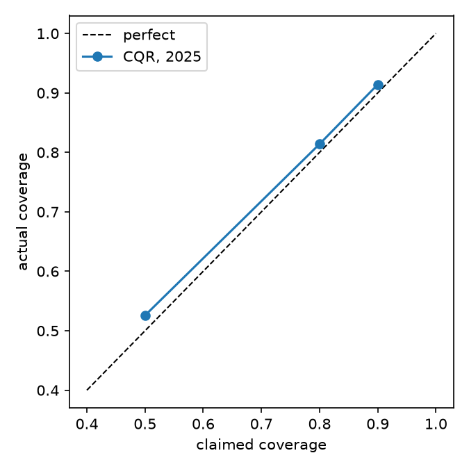

# F1 Race Strategy Lab

How well can you predict an F1 lap time from tyre age, fuel and conditions? How sure can the model honestly be? And is that good enough to compare pit strategies?

This repo is my attempt at all three, using lap data from 2022 to 2025. It has the notebooks, the code behind them, and what I found, including the parts that didn't work.

**The short version:**

- A lap-time model predicts how a lap differs from a driver's normal pace with a mean error of 0.62 s on 2025, a season it never saw. The best simple baseline is off by 0.87 s.
- The prediction intervals are honest. The ones I label 80% contain the real lap time 81.4% of the time on 2025.
- Putting this into a race simulator worked less well. It predicts a driver's total race time to within a median of 30 s on a race of about 5,500 s, but its intervals are too narrow (the 80% ones hold 65.6% of results), and the tyre model doesn't improve the race total over assuming constant pace.


## Contents

1. [Why this project](#why-this-project)
2. [Related work](#related-work)
3. [The data](#the-data)
4. [What I did, step by step](#what-i-did-step-by-step)
5. [Decisions and why](#decisions-and-why)
6. [Problems I ran into](#problems-i-ran-into)
7. [Results](#results)
8. [What the results mean](#what-the-results-mean)
9. [What I'd do differently](#what-id-do-differently)
10. [Limits and how the data was used](#limits-and-how-the-data-was-used)
11. [Using it](#using-it)

## Why this project

I like motorsport, and I wanted a project built around forecasting, uncertainty and simulation. F1 is a good fit because pit strategy is a real decision made under uncertainty, and there's public lap-by-lap data.

The question I kept coming back to was calibration. Plenty of models give you a number. I wanted one that also says how sure it is, and then I wanted to check that claim against races it hadn't seen.

## Related work

I did a short search for prior work after the main build, to place this properly. I only read the abstracts, so I'm not claiming a detailed comparison.

- Thomas et al., [*Explainable Reinforcement Learning for Formula One Race Strategy*](https://arxiv.org/abs/2501.04068) (2025), trains a reinforcement learning agent to choose tyre compounds and stop timing, and compares it with hard-coded baselines.
- Fieni et al., [*Towards Learning-Based Formula 1 Race Strategies*](https://arxiv.org/abs/2512.21570) (2025), optimises strategy including energy allocation, tyre wear and pit timing, and trains a reinforcement learning agent to approximate the optimum.
- Romano, Patterson and Candès, [*Conformalized Quantile Regression*](https://arxiv.org/abs/1905.03222) (NeurIPS 2019), is the method I use for the prediction intervals.

Those two F1 papers focus on finding good strategies. This project is smaller and asks a different question: how well calibrated is the lap-time forecast, and does a simulator built on it match what really happened when replayed against past races? It doesn't try to beat them at choosing strategies.

## The data

Lap-by-lap timing for every race from 2022 to 2025: lap time, tyre compound, tyre age, pit stops, weather, and safety car status.

I use two sources and merge them into one lap table:

- **FastF1** for 2022. Its [docs](https://docs.fastf1.dev/) say timing data is available from 2018, but from my machine the F1 timing server returned an authorisation error for 2023 and later. I couldn't find the cause, so FastF1 only works here for 2022 (and 2021).
- **[OpenF1](https://openf1.org)** for 2023 to 2025. It's a free API with laps, tyre stints, weather and race control messages.

The raw data isn't in this repo. `python -m f1lab.ingest` downloads and caches it. Check each source's terms before reusing the data.

After ingest there are 100,701 laps from 92 races. The 2023 Imola race was cancelled but still appears in OpenF1 with no data, so it's skipped.

## What I did, step by step

Each notebook builds on the last. They run in order.

**01 – Raw data overview.** What's in the lap table and what's missing. About 6% of ordinary laps are more than 7% slower than their race's median pace, which is far too many to be traffic. Once I labelled safety car and virtual safety car laps, that dropped to about 2%, so most of them were safety car laps.

**02 – Tyre wear and fuel burn.** The raw numbers suggest tyres get *faster* with age on every compound. That can't be wear. Cars burn fuel and get lighter every lap, and the gain is bigger than the wear. Once fuel is accounted for, wear shows up in the order you'd expect: soft 0.056, medium 0.038, hard 0.029 s per lap. Track temperature, which I expected to matter, shows no relationship with wear.

**03 – Baselines.** Predicting "no change from the driver's normal pace" is off by 0.88 s on average. Averages by compound or tyre age barely help (0.855). None of them know how far into the race it is.

**04 – Linear model.** Adding a fuel term takes the error from 0.85 to 0.63 s. Fuel is the main thing. Everything else is small.

**05 – Gradient boosting.** A small gradient-boosted model gets 0.60 s on 2024. Tyre age and the fuel terms are the only inputs that clearly help.

**06 – Prediction intervals.** Conformalized quantile regression gives intervals that match their claimed level on a held-out season, with one weakness: at tracks that weren't in the training data, coverage drops (about 65% for a claimed 80%).

**07 – Safety cars.** A rate model for when a safety car or virtual safety car starts. The first two laps carry about ten times the usual risk, and after that the rate is flat.

**08 – Race simulator.** Combines everything, plus pit stop costs, safety car laps and lap 1, and simulates a driver's race many times. I test it by replaying real 2024 races.

**09 – Final test on 2025.** The only place 2025 is used.

## Decisions and why

- **Target = lap time minus the driver's own median pace in that race.** This removes car, driver and track speed, so what's left is tyre, fuel and conditions. The catch is that in real use you'd need to supply the base pace (from practice, say). The replay test uses the race's own median, which is only known in hindsight.
- **Train on earlier seasons, test on the next one.** Never a random split of laps. Laps from one race are strongly linked, and a random split would leak.
- **MAE as the headline metric.** About 0.3% of laps are real incidents (spins, off-track moments) that can be 30 s slow. They dominate squared error and say little about typical laps.
- **Keep models small.** With two or three seasons of training data, gradient-boosting models beyond about 8 leaves got worse in cross-validation.
- **Keep the safety car model simple.** I tried a per-track rate and a race-stage effect. Neither predicted which held-out races got safety cars, so I kept one rate for laps 1–2 and one for the rest.
- **Don't tune on the test season.** Every setting was fixed on 2022–2024 before 2025 was run, and 2025 was run once.

## Problems I ran into

Some of these cost real time, and a few changed the results.

- **LightGBM wouldn't import on macOS.** It needed the OpenMP library (`brew install libomp`).
- **FastF1 couldn't load 2023 onwards.** Every data fetch failed with an authorisation error, even though the docs say it should work. Reproducing the failure with the library's own requests, not hand-built URLs, was what made it clear. I added OpenF1 as a second source.
- **The two sources name tracks differently.** "Monaco" and "Monte Carlo" showed up as two circuits. Seven tracks needed mapping, or every per-track result would have been split in half.
- **Wet races leaked into everything.** My first rule for spotting wet or drying races compared early and late laps, but a wet start leaves no clean early laps, so the check returned a missing value and the race was quietly treated as dry. I only found it because one race had very poor interval coverage and I looked at why. The fix was to also flag races where a large share of laps were on intermediate or wet tyres. It improved every model, and I had to re-run and rewrite four notebooks.
- **The rain flag in the data can't be trusted.** At Spa 2025 the track dried out after a wet start while the flag said dry all race.
- **I mis-measured a calibration check.** My first safety car check used only the laps that were "at risk". A race with a long safety car loses at-risk laps, which built in a fake negative correlation. I nearly picked a model because of it.
- **Safety car laps changed between seasons.** 2022 averaged 1.33× a normal lap and 2023 to 2025 about 1.45 to 1.49×. That was the data source, not the sport: FastF1 marks a lap as safety car if any part of it was. The simulator now learns safety car costs from the OpenF1 seasons only.
- **Safety car laps move together.** Drawing each lap's slowdown independently made the simulator overconfident (67% coverage in safety car races). Drawing one value per safety car period fixed most of it (85%).
- **A few plain bugs:** a strategy search that was about 100× too slow because the lap-time table was recomputed for every plan, and a notebook cell that recomputed the same set 100,000 times and hung for minutes.

## Results

All numbers below are on 2025, the held-out season, with models trained on 2022–2024.

### Lap-time model

20,807 laps from 21 races. Error is in seconds, against the driver's own median pace.

| Model | Mean abs error | RMSE |
|---|---|---|
| Predict no change | 0.894 | 1.550 |
| Mean by compound | 0.876 | 1.537 |
| Mean by compound and tyre age | 0.870 | 1.532 |
| Linear (robust) | 0.637 | 1.379 |
| Gradient boosting | **0.621** | 1.370 |

Gradient boosting is about 29% better than the best simple baseline. Its edge over the linear model is small (0.016 s here, 0.030 s on 2024).

### Prediction intervals

| Claimed | Actual | Average width |
|---|---|---|
| 50% | 52.6% | 0.89 s |
| 80% | 81.4% | 1.80 s |
| 90% | 91.4% | 2.55 s |



### Safety cars

Log loss 0.0845 against 0.0917 for a single constant rate. The model expects 1.15 safety car or virtual safety car starts per race, and there were 1.05 (22 in 21 races). It can't say *which* races will have one. I tested that and nothing I tried could.

### Race simulator (replay of 2025)

I replay each driver's real strategy and the real safety car laps, then compare the predicted total race time with the actual one. 276 driver-races from 20 races.

| | Median error | 80% interval holds |
|---|---|---|
| Just base pace × laps | 164 s | – |
| Simulator | 30.3 s | 65.6% |
| Same simulator with no tyre or fuel effect | 28.1 s | 72.1% |

Claimed 50%, 80% and 90% intervals held 41.7%, 65.6% and 77.5%.

On 2024, with the same design, the median error was 18.1 s and the intervals were well calibrated (50%, 80%, 90% → 52.9%, 80.2%, 89.4%).


## What the results mean

**What held up.** Fuel burn is the biggest factor in lap time, and a model that knows about it is close to 30% better than one that doesn't. The intervals do what they claim on a season the model never saw. The safety car rate is about right on average.

**What didn't.** The simulator's total-time intervals were too narrow on 2025. Most of the error sits at the race level: the average error differs between races by about 52 s, but drivers inside one race differ from each other by only about 22 s, and three races account for 60% of the squared error. How a particular race's safety cars play out shifts every driver together, and an average can't capture that. That should matter less when comparing strategies inside one race, but I haven't tested that directly.

**The tyre model doesn't help the race total.** A version of the simulator with no tyre or fuel effect did slightly better. A driver's base pace is their own median lap from that race, so it already absorbs the average shape, and the total barely depends on how time is spread across stints. If the tyre model is useful, it's for comparing strategies, and that part isn't well tested here.

**A check I ran after seeing the 2025 result.** Stops under a safety car or VSC got cheaper every year (23.7 s in 2022, then 17.3, 12.5 and 10.5 s). I wondered if that explained the miss, so I tried learning those costs from 2024 only. It barely moved anything (median error 30.3 s to 29.7 s), so the drift isn't the explanation. I did this after seeing the test result, so I haven't treated it as a tuned model.

**On strategy advice.** The simulator can rank plans, and for the 2024 Sakhir winner it preferred a one-stop over the two-stop he actually ran, by about 14 s on average. I wouldn't read that as advice. In quiet 2025 races it was too pessimistic about one-stop races by about 16 s, so it leans toward recommending more stops than were needed, and a wear model that's close to linear can't see a tyre cliff.

## What I'd do differently

- **Let safety car costs vary per race** with a shared random effect, so intervals widen where they should. This is the clearest next step given where the error sits.
- **Model tyre wear per track and allow a cliff**, not one nearly linear shape per compound.
- **Test strategy comparisons directly.** For example, check whether the simulator correctly ranks one-stop against two-stop plans within the same race across many races.
- **Forecast base pace** from practice data instead of using the race median in hindsight.
- **Get more seasons.** Three training seasons is thin, and the per-track effects were too noisy to use. Older seasons would help, but the 2022 rules changed the cars, so they'd need care.
- **Compare against published strategy models**, which I only read the abstracts of.

## Limits and how the data was used

- **Base pace is known in hindsight** in the replay test, and so are the safety car laps. The test checks the lap-time model, pit costs and safety car costs. It doesn't test forecasting pace or predicting safety cars.
- **Cleaning rules were set looking at all four seasons.** The thresholds for dropping wet races, extreme slow laps and drying starts were chosen while I could see 2025 data, and the Spa 2025 plot is where I first noticed the wet-race problem. Model fitting and tuning used 2022–2024 only, and 2025 results were produced once. Three 2025 races (Melbourne, Silverstone, Spa) are excluded by the wet-race rules, so the test set has 21 races, not 24.
- **Only dry races.** Twelve wet or drying races across the four seasons are excluded.
- **One test season.** A single season is a small sample. 2024 and 2025 gave noticeably different simulator results.
- **Few safety car events.** About 60 in the training seasons.
- **Two data sources label safety car laps slightly differently.** FastF1 (2022) is less precise than OpenF1 (2023 on).
- **Used tyre sets** are handled from the real data in the replay test, but the strategy search assumes every later stint starts on a new set.

## Using it

### Setup

```bash
python3 -m venv .venv && source .venv/bin/activate
pip install -r requirements.txt
pip install -e .
python -m ipykernel install --user --name f1lab
```

On macOS, LightGBM also needs `brew install libomp`.

### Build the data

```bash
python -m f1lab.ingest   # downloads and caches FastF1 (2022) and OpenF1 (2023-2025), takes several minutes
python -m f1lab.clean    # writes data/laps_clean.parquet
```

Then open the notebooks in `notebooks/` and run them in order.

### Rank strategies for a race

```bash
python -m f1lab.cli --track Sakhir --laps 57 --pace 95.5 --track-temp 30 --air-temp 25
```

`--pace` is the driver's typical clean lap in seconds. It prints the plans with the lowest average race time:

```
2112 plans, 200 simulated races each. Best first:

     plan  stops      mean behind   sd beats_best
H35 > S22      1 1:33:26.8  +0.0s 151s         0%
H40 > S17      1 1:33:27.1  +0.3s 150s        38%
H35 > M22      1 1:33:27.4  +0.6s 151s         0%
```

Plans within about a second of each other are effectively tied. Treat the order as a guide, not a prediction.

### In Python

```python
import pandas as pd
from f1lab.simulate import build_simulator, rank_strategies

raw = pd.read_parquet("data/laps.parquet")
clean = pd.read_parquet("data/laps_clean.parquet")
sim = build_simulator(raw, clean, seasons=(2022, 2023, 2024))
plans = rank_strategies(sim, "Sakhir", race_laps=57, base_pace=95.5, track_temp=30, air_temp=25)
```

### Layout

```
notebooks/   numbered notebooks, run in order
src/f1lab/   the code the notebooks use (loaders, cleaning, models, simulator)
reports/     figures and the final result numbers (final_results.csv)
data/        local cache of downloaded data, not committed
tests/       unit tests, run with pytest
```
